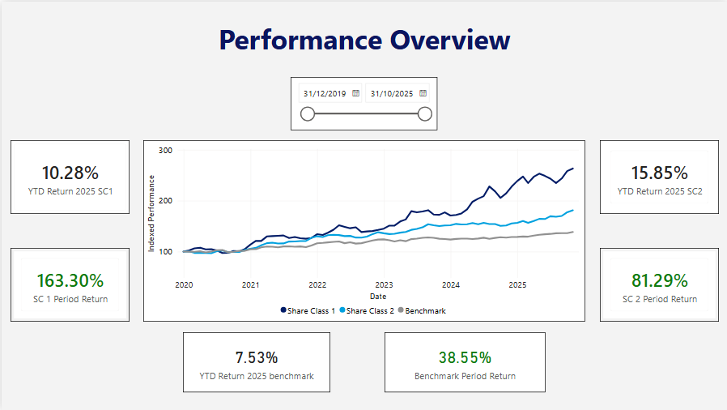
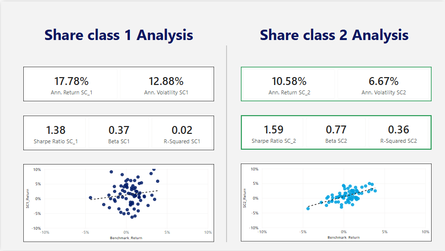

Here is the complete, start-to-finish text to copy and paste directly into your GitHub README.md file. It corrects all image and file paths to match your flat root directory so every link, equation, and image renders immediately.   Markdown# Quantitative Performance & Risk Analytics: The Compounding Fallacy & Fund Benchmarking

An applied quantitative investment analysis and business intelligence project demonstrating:
1. Why **arithmetic averaging misrepresents multi-period returns** (The Compounding Trap)[cite: 3, 4].
2. Institutional risk-adjusted performance attribution (**Sharpe Ratio**, **Annualized Volatility**, **CAPM Beta**, and **$R^2$**) across simulated share classes and a market benchmark[cite: 1, 3].
3. Resolving **non-trading day calendar gaps** in Power BI / DAX time-intelligence functions[cite: 1, 3].

---

## The Compounding Fallacy: Arithmetic Mean vs. Geometric Return (CAGR)

A frequent error in performance evaluation is averaging multi-period returns arithmetically[cite: 3, 4]. Because capital scales multiplicatively rather than additively, arithmetic averages systematically overstate investment outcomes[cite: 3, 4]:

```text
Initial Capital: $100
├── Year 1: +50% gain  ──> Portfolio Value: $150
└── Year 2: -50% loss  ──> Portfolio Value: $75
```

### The Conflict
* **Arithmetic Average:** $\frac{(+50\%) + (-50\%)}{2} = \mathbf{0.00\%}$ (Suggests no capital was lost)[cite: 3, 4]
* **Actual Realized Net Return:** $\frac{75 - 100}{100} = \mathbf{-25.00\%}$[cite: 3, 4]
* **True Compound Annual Growth Rate (CAGR):**
  $$\text{CAGR} = \left(\frac{75}{100}\right)^{\frac{1}{2}} - 1 = \sqrt{0.75} - 1 \approx \mathbf{-13.40\% \text{ p.a.}}$$
[cite: 3]

> **Core Financial Takeaway:** Returns are path-dependent[cite: 3]. A 50% drawdown requires a **+100% gain** just to restore the initial balance. Geometric annualization (CAGR) accounts for the fluctuating capital base, providing the only mathematically valid metric for multi-year capital growth[cite: 3].

---

##  Analytical Scope & Dataset Overview

Using simulated monthly Net Asset Values (NAV) spanning **December 2019 to October 2025**, two distinct fund share classes were evaluated against a broad market benchmark[cite: 1, 3]:

* **Share Class 1 (SC1):** Growth-oriented, low-correlation strategy[cite: 1, 3].
* **Share Class 2 (SC2):** Capital-efficiency, market-linked strategy[cite: 1, 3].
* **Base Re-indexing:** All historical NAV series rebased to an index of 100 as of $31.12.2019$[cite: 3]:
  $$\text{Rebased Price}_t = \left(\frac{\text{Current Price}_t}{\text{Starting Price}_0}\right) \times 100$$
[cite: 3]

---

## 📊 Summary of Results & Key Metrics

| Metric | Share Class 1 (SC1) | Share Class 2 (SC2) | Benchmark | Strategic Interpretation |
| :--- | :---: | :---: | :---: | :--- |
| **2025 YTD Return** | 10.28% | 15.85% | 7.53% | SC2 captured current market momentum[cite: 1, 3] |
| **Annualized Return (CAGR)** | 17.78% | 10.25% | — | SC1 dominates long-term capital accumulation[cite: 1, 3] |
| **Annualized Volatility ($\sigma_{ann}$)** | 12.88% | 6.67% | — | SC2 offers half the risk profile of SC1[cite: 1, 3] |
| **Sharpe Ratio** | 1.38 | 1.59 | — | **SC2 delivers superior risk-adjusted efficiency**[cite: 1, 3] |
| **Market Beta ($\beta$)** | 0.37 | 0.77 | 1.00 | SC1 is defensive/decoupled; SC2 tracks benchmark[cite: 1, 3] |
| **Coefficient of Determination ($R^2$)** | 0.02 | 0.36 | 1.00 | SC1 driven by manager alpha; SC2 driven by market beta[cite: 1, 3] |

---

##  Econometric & Methodological Framework

### 1. Geometric Annualization (CAGR)
Annualized return is calculated using a point-to-point approach to isolate true capital appreciation[cite: 1, 3]:
```dax
Ann. Return SC_1 = 
VAR StartPrice = CALCULATE(SUM(SimulatedData[ShareClass1]), FIRSTDATE('Calendar'[Date]))
VAR EndPrice = CALCULATE(SUM(SimulatedData[ShareClass1]), LASTDATE('Calendar'[Date]))
VAR TotalMonths = COUNTROWS(DISTINCT('SimulatedData'[Date]))
VAR NumYears = TotalMonths / 12
RETURN
    ( (EndPrice / StartPrice) ^ (1 / NumYears) ) - 1
```

### 2. Risk Scaling via the Square Root of Time
Risk cannot be measured point-to-point; it requires calculating periodic dispersion across continuous holding periods[cite: 1, 3]. Monthly sample standard deviation is scaled to an annual standard:
```dax
Ann. Volatility SC1 = 
STDEVX.S(
    'SimulatedData',
    'SimulatedData'[SC1_Return]
) * SQRT(12)
```
*Why multiply by $\sqrt{12}$ instead of 12?* Financial returns follow a random-walk assumption where variance scales linearly with time ($t$), meaning standard deviation (volatility) scales with the square root of time ($\sqrt{t}$)[cite: 1, 3]. Multiplying directly by 12 assumes volatility moves in the exact same direction every single month, severely overstating systemic risk[cite: 1].

### 3. Data Engineering: Solving Non-Trading Day Gaps
* **The Problem:** Standard DAX time-intelligence functions (`DATEADD`, `FIRSTDATE(DATESMTD)`) navigate continuous Gregorian calendars[cite: 1, 3]. In financial markets, equities do not trade on weekends or bank holidays[cite: 1, 3]. Comparing Monday close to Sunday yields blank or null values[cite: 3].
* **The Solution:** Transitioned the calculation logic from static dates to a sequential active trading-day index querying actual transaction dates (`StockData`) directly[cite: 1, 3], successfully skipping non-trading gaps[cite: 1, 3].

---

## 📈 Interactive Dashboard Preview

### Portfolio Performance Overview


### Share Class Deep Dive & Regression Analysis


---

## 📁 Repository Structure

```text
├── LICENSE
├── README.md                              <-- Project documentation & econometric methodology
├── fund_performance_risk_engine.pbix     <-- Interactive Power BI report file
├── simulated_fund_benchmark_data.xlsx    <-- Cleaned simulated NAV & benchmark dataset
├── dashboard_overview.png                 <-- Dashboard overview preview image
├── risk_metrics_scatter.png               <-- Regression & risk deep-dive visual
├── cagr_geometric_annualization.txt       <-- DAX: Point-to-point geometric CAGR
├── dax_annualized_volatility.txt          <-- DAX: Volatility scaled by sqrt(12)
└── daxtrading_calendar_workaround.txt     <-- DAX: Non-trading session offset logic
```
